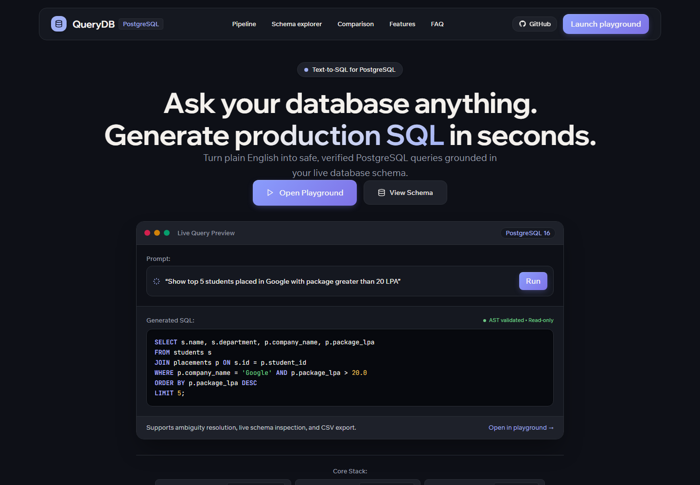
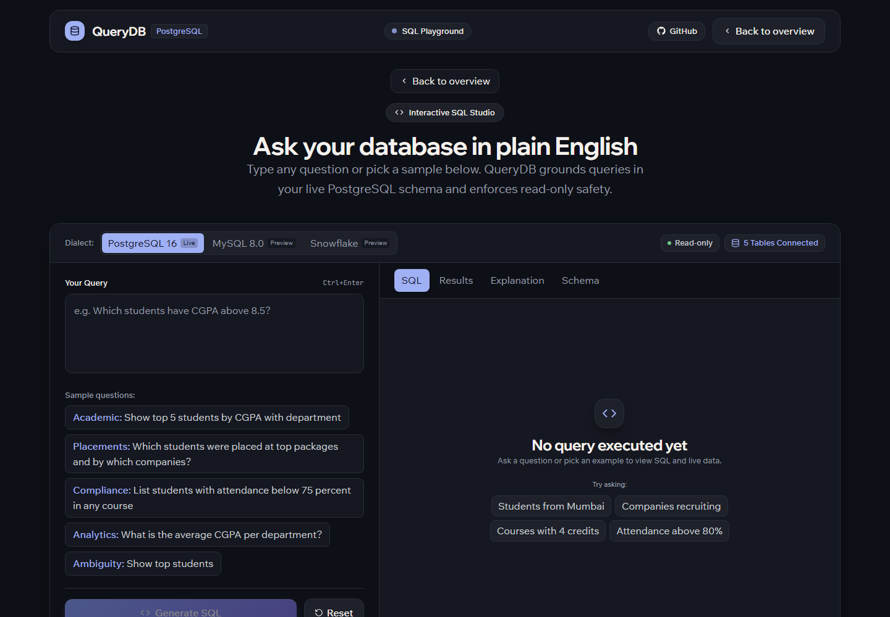

# QueryDB

### Ask your database in plain English.

QueryDB finds relevant PostgreSQL tables, generates a `SELECT`, checks that it is read-only, runs it, and explains the result.

[](https://nodejs.org/)
[](https://react.dev/)
[](https://fastapi.tiangolo.com/)
[](https://www.postgresql.org/)
[](https://ai.google.dev/)

> 🔒 **Safety first:** The browser never connects directly to Postgres or the model. The API validates the generated query and executes it in a read-only transaction.

## ✨ Features

- 🧠 **Schema-aware retrieval** — FAISS and `all-MiniLM-L6-v2` find relevant public tables, so the model gets focused schema context.
- 💬 **Smart clarification** — Ambiguous requests, such as “top students,” prompt for a choice before SQL is generated.
- 🛡️ **Read-only queries** — `sqlglot` allows a single `SELECT`; Postgres executes it in a read-only transaction with a 5-second statement timeout.
- 📊 **Understandable results** — See the generated SQL, returned rows, and a plain-language explanation.
- 🔄 **Live schema** — `GET /api/schema` reads the connected database's tables, columns, and relationships.

## 🖼️ Screenshots

<p align="center">
  
  
</p>

## 🔄 How it works

1. The studio sends your question to `POST /api/query`.
2. If the request is unclear, QueryDB asks you to choose what you mean.
3. The AI service retrieves relevant schema context, generates a `SELECT`, and validates it.
4. The API runs the approved query and returns the results with an explanation.

## 🚀 Project setup

### Prerequisites

- Node.js 18+
- Python 3.10+
- PostgreSQL 14+
- A Gemini API key

### 1. 📥 Get the project

```powershell
git clone https://github.com/Komal-kushwaha24/QueryDB.git
cd QueryDB
```

### 2. 🗄️ Prepare PostgreSQL

Create a PostgreSQL database (the default name is `QueryDB`) and make sure the account you use can connect to it. QueryDB reads tables from the database's `public` schema. The SQL files in `database/` are placeholders and do not create or seed tables; add your own schema and data before trying sample questions.

Run each service in its own terminal and leave it running while you use the app.

### 3. 🧩 Start the API

```powershell
cd server
copy .env.example .env
npm install
npm run dev
```

Set `DB_USER` and `DB_PASSWORD` in `server/.env` to match your PostgreSQL account. The API listens on [http://localhost:3000](http://localhost:3000).

### 4. 🤖 Start the AI service

```powershell
cd ai-service
python -m venv .venv
.\.venv\Scripts\activate
pip install -r requirements.txt
```

Create `ai-service/.env` with your Gemini API key and the API's schema endpoint:

```dotenv
GEMINI_API_KEY=your_key
SCHEMA_API_URL=http://localhost:3000/api/schema
```

Start FastAPI after the API is running, so the schema index can load:

```powershell
uvicorn app.main:app --host 127.0.0.1 --port 8001 --reload
```

On macOS or Linux, activate the virtual environment with `source .venv/bin/activate`.

### 5. 🎨 Start the studio

```powershell
cd client
npm install
npm run dev
```

Open [http://localhost:5173](http://localhost:5173). Vite proxies `/api` to port 3000. The playground is at [http://localhost:5173/#playground](http://localhost:5173/#playground).

The first schema load downloads the embedding model. If Gemini returns a quota error, generation falls back to a schema-aware offline statement.

## 📁 Folder structure

```text
QueryDB/
├── ai-service/
│   ├── app/
│   │   ├── ambiguity/      Clarification and result explanations
│   │   ├── rag/            Schema loading, embeddings, and retrieval
│   │   ├── sql_safety/     Read-only SQL validation
│   │   └── text_to_sql/    Prompting and SQL generation
│   ├── tests/              AI service tests
│   └── requirements.txt
├── client/
│   └── src/
│       ├── components/     React UI sections and playground
│       ├── data/           Example playground data
│       └── services/       API client
├── database/               Placeholder schema and seed SQL
├── docs/
│   ├── screenshots/        Application screenshots
│   └── architecture and retrieval notes
└── server/
    ├── src/
    │   ├── config/         PostgreSQL connection
    │   ├── controllers/    Request handlers
    │   ├── routes/         Express routes
    │   └── services/       AI integration and query execution
    └── test/               API tests
```

## 🔌 API

The studio uses these Express routes.

`POST /api/query`

```json
{ "question": "Which students have a CGPA above 8.5?" }
```

Completed:

```json
{
  "success": true,
  "status": "completed",
  "sql": "SELECT name, cgpa FROM students WHERE cgpa > 8.5;",
  "explanation": "Lists students whose CGPA is above 8.5.",
  "columns": ["name", "cgpa"],
  "rows": [{ "name": "Priya Sharma", "cgpa": "9.85" }],
  "rowCount": 1
}
```

Needs a choice:

```json
{
  "success": true,
  "status": "clarification_required",
  "clarification": {
    "question": "How should top students be ranked?",
    "options": ["Highest CGPA", "Highest placement package"]
  }
}
```

Send the chosen option back as `selectedOption`. An empty question returns `422`. SQL that fails the safety check returns `400` with code `UNSAFE_QUERY`.

| Method | Path | Purpose |
| --- | --- | --- |
| `GET` | `/api/health` | API process is up |
| `GET` | `/api/health/db` | `SELECT 1` against Postgres |
| `GET` | `/api/schema` | Public tables, columns, keys, and foreign keys |
| `POST` | `/api/query` | Clarify, generate, validate, and execute |
| `POST` | `/api/ai/clarify` | Clarification only |
| `POST` | `/api/ai/explain` | Explanation for a question and a SQL string |

FastAPI, on port 8001, exposes `POST /rag/refresh`, `POST /rag/retrieve`, `POST /rag/context`, `POST /sql/generate`, `POST /sql/validate`, `POST /ambiguity/clarify`, and `POST /text-to-sql/explain`. Express already calls the ones it needs. Refresh the index with `POST /rag/refresh` after you change tables.

## 🧪 How to test

Run each command from the repository root. The test suites are separate from the services' development servers.

**API tests**

```powershell
npm --prefix server test
```

**AI service tests**

```powershell
.\ai-service\.venv\Scripts\python -m pytest .\ai-service\tests
```

**Studio production build**

```powershell
npm --prefix client run build
```

The API tests cover query validation, safety rejection, and read-only execution. The Python tests cover retrieval, ambiguity, generation, and the SQL guard. The client command checks that the studio builds successfully.

## 🗺️ Future scope

Possible directions for future development:

- 🔐 Add user authentication, database-level permissions, and configurable access controls.
- 🗃️ Support multiple database connections and additional SQL database engines.
- 📌 Save, revisit, and share query history and reusable questions.
- 📤 Export results to CSV or other common formats.
- 📈 Add richer visualizations and dashboards for query results.
- 🧪 Improve query quality with evaluation datasets, usage feedback, and operational monitoring.

---

<p align="center">
  Built with React, Express, FastAPI, and PostgreSQL
  <br />
  <a href="#querydb">Back to top ↑</a>
</p>
